# F1 Analytics

[Español](README.md) · **English**

A web app that helps you understand a Formula 1 session using real data from [OpenF1](https://openf1.org). Pick a year (from 2023), a Grand Prix and a session, and the app answers three questions with a circuit map, a tyre strategy view and a two-lap comparison. Available in Spanish and English.

**[Open the web app](https://f1-analytics-eta.vercel.app/en)** · [Service status](https://f1-analytics-eta.vercel.app/en/estado) · [API](https://f1-analytics-api-a6xc.onrender.com/docs)

> The free-tier API goes to sleep after 15 minutes without traffic: the first visit can take up to a minute to respond. After that it is fast.

> The screenshots below show the Spanish interface; the app is fully available in English at the link above.

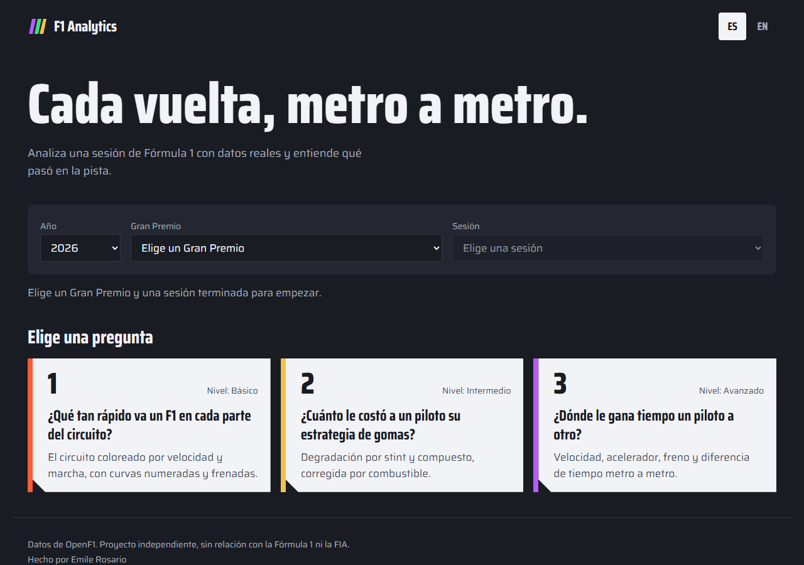

## The three questions

### 1. How fast does an F1 car go in each part of the circuit?

A driver's fastest lap painted on the track map: speed at each point, the gear in use, numbered corners and where each braking zone starts.

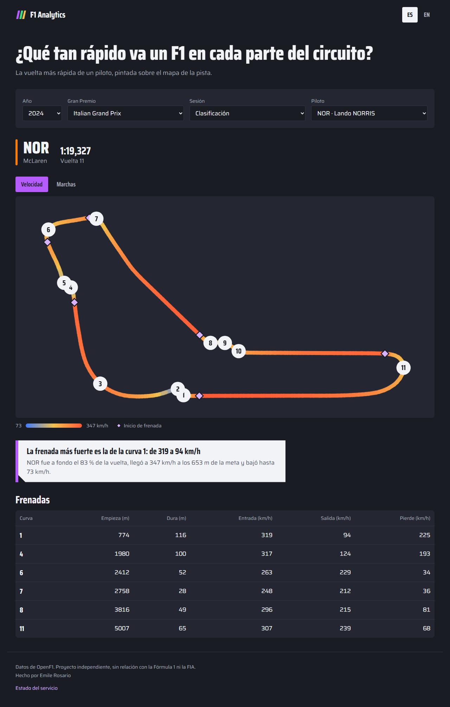

**What the 2024 Italian GP pole lap shows (Lando Norris, 1:19.327):**

- He was at full throttle for **83 %** of the lap, at the circuit with the least downforce on the calendar.
- He reached **347 km/h** 653 m after the line and dropped to **73 km/h**.
- The hardest braking is **turn 1**: from 319 to 94 km/h in 116 m.

<details>
<summary>The same figures, made with Matplotlib in notebook 01</summary>

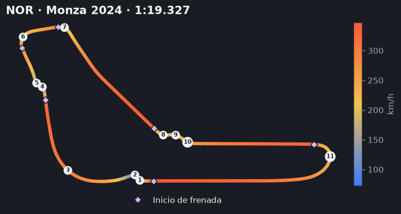
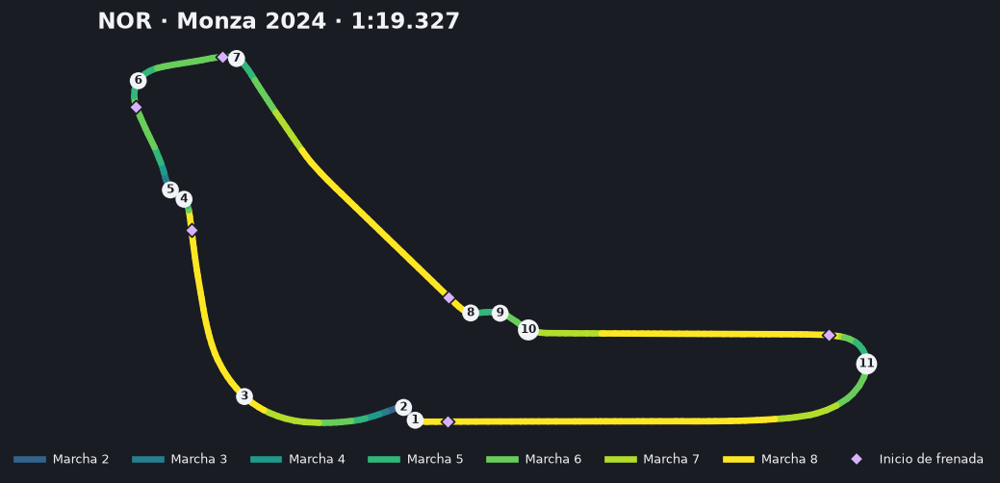

</details>

### 2. How much did a driver's tyre strategy cost?

Every driver's strategy (which compound, how many laps), lap time against tyre age, and how much each compound wears, with an optional correction for the fuel burning off.

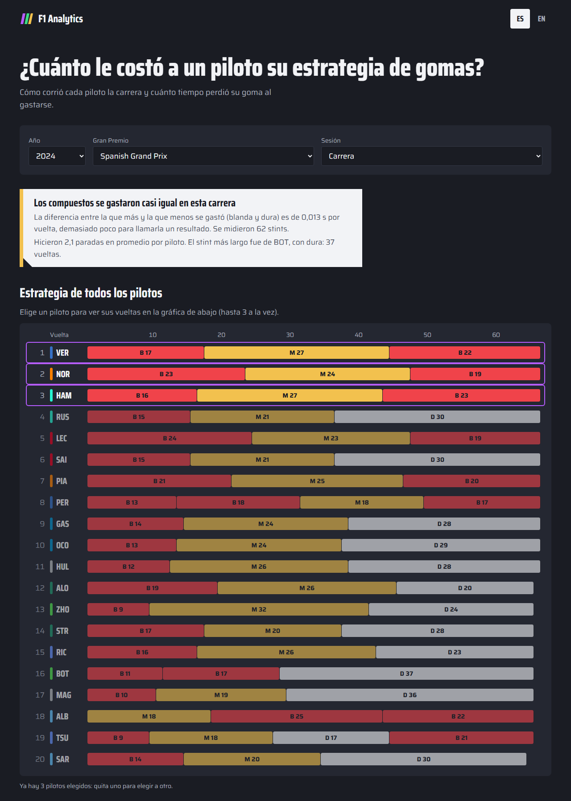

**What the 2024 Spanish GP shows (62 stints):**

- With fuel corrected, the soft loses **0.099 s per lap**, the medium 0.089 and the hard 0.085.
- The gap between the one that wears most and the one that wears least is **0.013 s per lap**: too small to call a result. The web app says so instead of inventing a winner.
- Without the fuel correction all three seem to wear far less (between 0.026 and 0.039 s per lap), because the car gets lighter and hides the wear.
- Drivers made **2.1 stops** on average. The longest stint was Bottas's, on the hard: 37 laps.

<details>
<summary>The same figures, made with Matplotlib in notebook 02</summary>

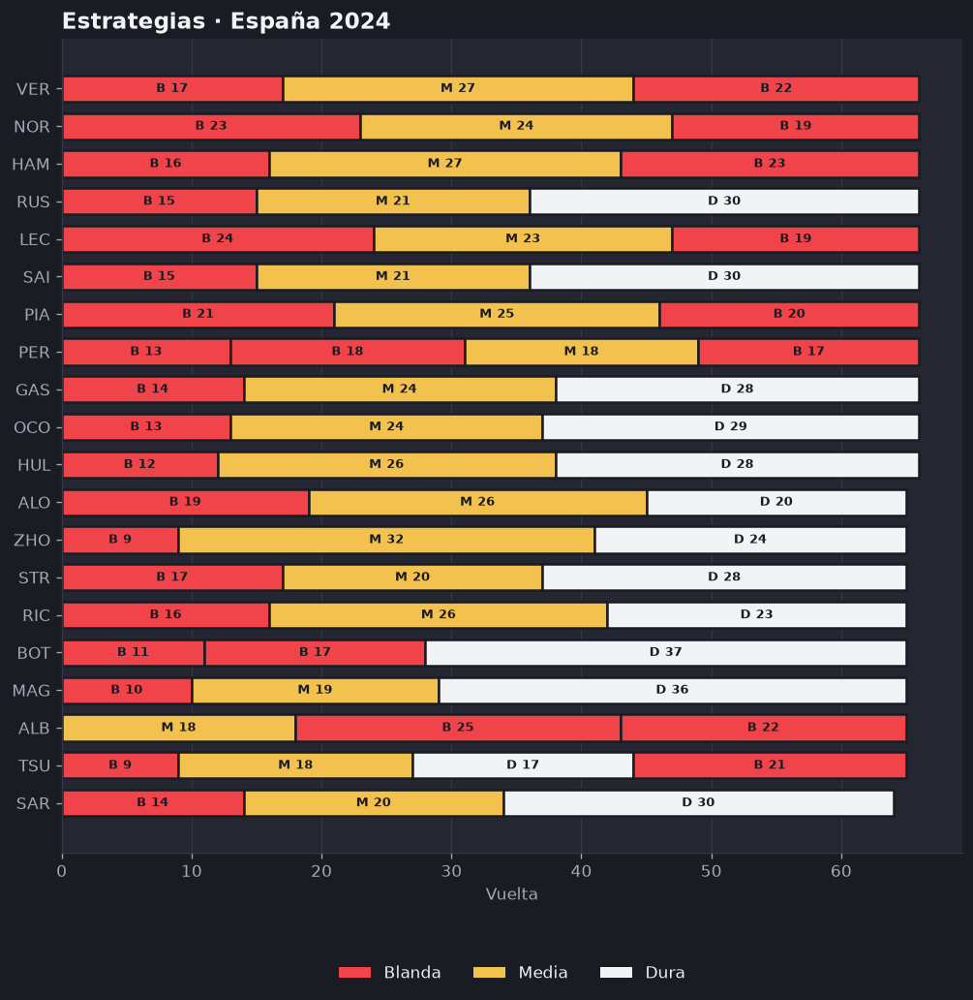
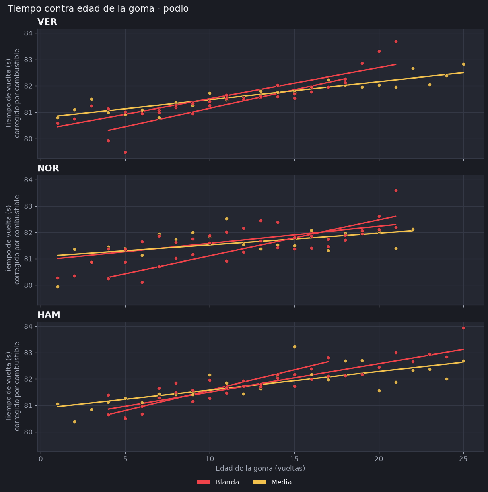
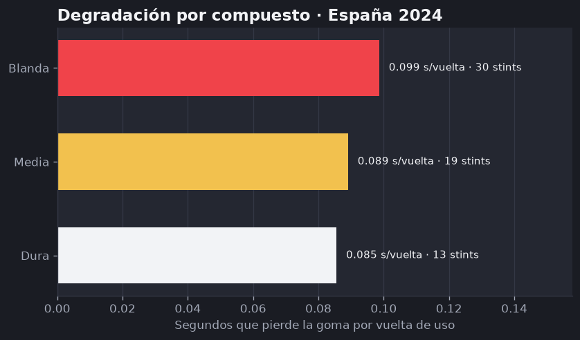

</details>

### 3. Where does one driver beat another?

Two drivers' laps on top of each other, metre by metre: speed, throttle, brake and the accumulated time difference. A cursor sweeps the lap (mouse, touch or keyboard) and the map paints each of 25 equal sections in the colour of whoever drove it faster.

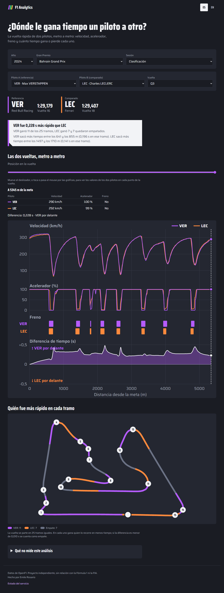

**What Bahrain 2024 Q3 shows (Verstappen 1:29.179 against Leclerc 1:29.407):**

- Verstappen was **0.228 s** faster.
- He won **11 of the 25 sections**; Leclerc won 7 and another 7 were ties (under 0.01 s apart).
- Verstappen gained **0.196 s** between 641 and 855 m, and Leclerc took back **0.141 s** between 1497 and 1710 m.

<details>
<summary>The same figures, made with Matplotlib in notebook 03</summary>

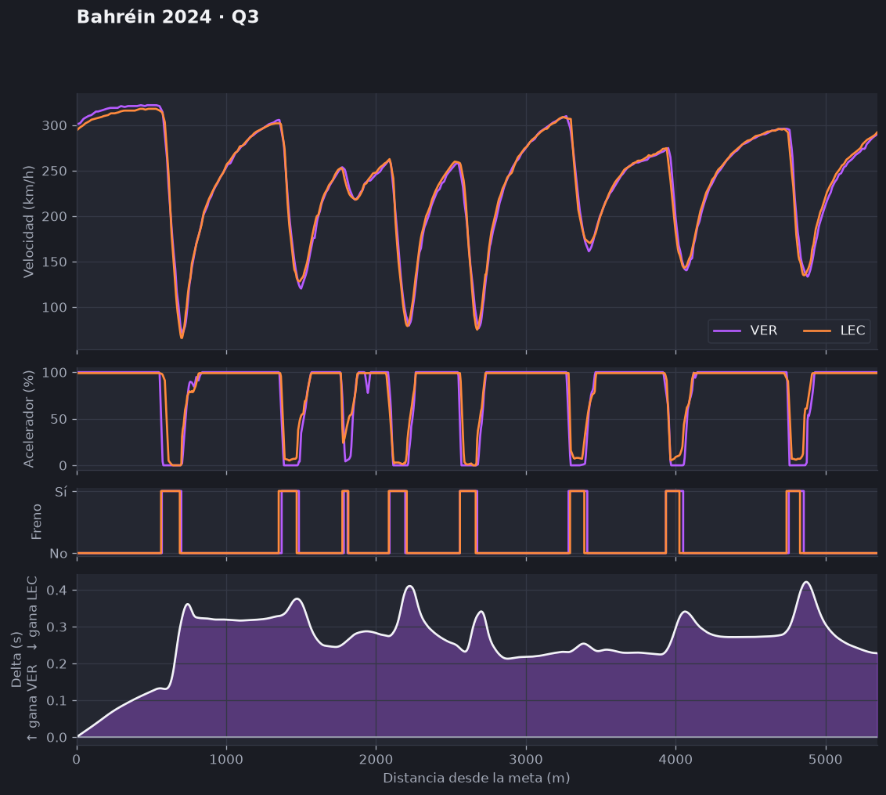
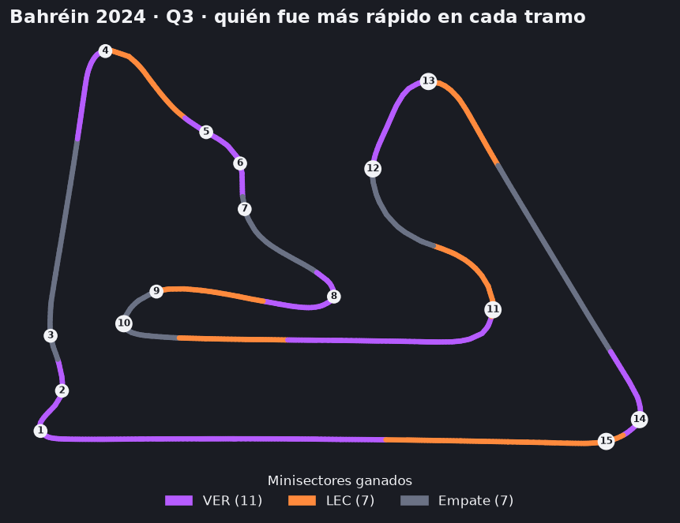

</details>

## How reliable is it

OpenF1's public data has about 3.7 samples per second, one every 20 m at 250 km/h. Because of that:

- **The final time difference is exact**: the calculation is fitted to each lap's official time.
- **Mid-lap it is an estimate.** It was measured against the official sector times in 6 Q3 comparisons from 5 races in 2024: mean error **0.03 s**, maximum **0.11 s**. Good enough to say who was faster over a long section, not to argue about a thousandth.
- **Tyre degradation is not real wear.** It is the slope of lap time against tyre age; traffic, temperature and the track rubbering in are mixed in too. With this data they cannot be separated.
- **Small differences are not presented as results.** If two drivers or two compounds are closer than a threshold, the web app says so and names no winner.

Every analysis page lists what it cannot say.

## How it is built

```
OpenF1 ──► backend/datos ──► backend/analisis ──► backend/api ──► frontend (Next.js)
           (the only layer     (pure functions,      (FastAPI,       (maps and charts
            that talks to       no network)           data only)      in custom SVG)
            OpenF1, cached)
                                     └──► notebooks/ + graficos/ (Matplotlib, the figures above)
```

- **Backend:** Python 3.12, FastAPI, pandas and numpy, managed with `uv`. The analysis functions are pure and tested without network. **The API never sends user-facing text**, only data and codes: the frontend translates them.
- **Frontend:** Next.js 16, React 19, TypeScript, Tailwind v4 and `next-intl` (Spanish and English). Maps and charts are custom SVG, with no charting library.
- **Deployment:** web on Vercel, API on Render.
- **Tests:** over 350 in the backend (with OpenF1 mocked), 191 unit tests and 57 end-to-end tests with Playwright in the frontend. CI on GitHub Actions, on Linux and Windows.
- **Accessibility:** controls work with the keyboard, the telemetry cursor has a slider for keyboard and screen readers, and compounds and drivers carry a letter or code as well as colour.

The notebooks in [`backend/notebooks/`](backend/notebooks/) walk through each analysis step by step, already executed with real data, using the same code the web app serves. They are written in Spanish.

## Documentation

The project documents are in Spanish:

- [`docs/contexto.md`](docs/contexto.md): what the project is, decisions and scope.
- [`docs/diseno-tecnico.md`](docs/diseno-tecnico.md): architecture, API and roadmap.
- [`docs/design.md`](docs/design.md): visual design.

## Run it locally

With Docker (API on `:8000`, web on `:3000`):

```
docker compose up --build
```

Without Docker:

```
# Backend (requires uv)
cd backend
uv sync
uv run uvicorn f1analytics.api.main:app --reload

# Frontend (requires Node 22)
cd frontend
npm ci
npm run dev
```

Tests:

```
cd backend && uv run pytest
cd frontend && npm test
```

The notebooks need internet access and no live F1 session (OpenF1 blocks keyless queries while one is running).

## Environment variables

| Variable | Where | What for |
|---|---|---|
| `NEXT_PUBLIC_API_URL` | Frontend (Vercel) | API URL. Locally, `http://localhost:8000` (see `frontend/.env.example`) |
| `ORIGENES_PERMITIDOS` | API (Render) | Comma-separated frontend domains allowed by CORS. Defaults to `http://localhost:3000` |
| `ORIGEN_PREVIEW_REGEX` | API (Render) | Regular expression for Vercel preview URLs |

## Known limits

- No live sessions: while a session is running, OpenF1 blocks queries and the web app says so.
- Circuits missing from `circuitos.json` (for example Kuala Lumpur and Madring) have no map and return "analysis not available".
- The telemetry comparison does not explain why a difference exists: a better braking point, a better line or a lifted foot all look the same in the delta.
- The 25 sections are equal in length, not the official mini-sectors (almost half of the circuits have none).

## Data sources

- Telemetry, laps and sessions: [OpenF1](https://openf1.org), queried live.
- Corner numbers and map rotation: a static copy of the public [MultiViewer](https://multiviewer.app) API (`backend/src/f1analytics/datos/circuitos.json`), generated once. The app does not depend on MultiViewer while running.

## Credits

Made by [Emile Rosario](https://github.com/emile-rosario), with [Claude Code](https://claude.com/claude-code) as a development assistant: Claude wrote and tested the code in small Pull Requests, and Emile reviewed and merged each one.

## License

[MIT](LICENSE). An independent project, not affiliated with Formula 1 or the FIA. It uses no official F1 logos, fonts or trademarks.
