# F1 Analytics

**Español** · [English](README.en.md)

Aplicación web para entender una sesión de Fórmula 1 con datos reales de [OpenF1](https://openf1.org). Eliges un año (desde 2023), un Gran Premio y una sesión, y la app responde tres preguntas con el mapa del circuito, la estrategia de gomas y la comparación de dos vueltas. En español e inglés.

**[Abrir la web](https://f1-analytics-eta.vercel.app)** · [Estado del servicio](https://f1-analytics-eta.vercel.app/es/estado) · [API](https://f1-analytics-api-a6xc.onrender.com/docs)

> La API gratuita se duerme tras 15 minutos sin tráfico: la primera visita puede tardar hasta un minuto en responder. Después va rápido.

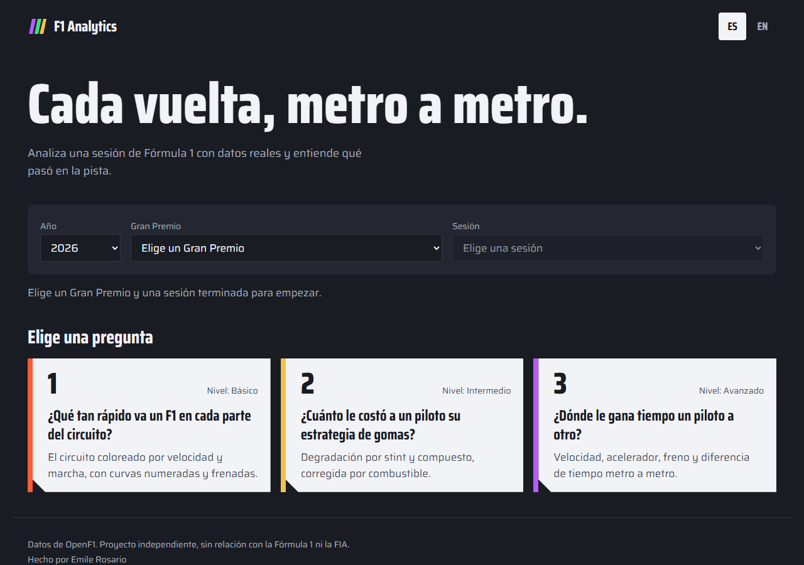

## Las tres preguntas

### 1. ¿Qué tan rápido va un F1 en cada parte del circuito?

La vuelta más rápida de un piloto, pintada sobre el mapa de la pista: la velocidad en cada punto, la marcha engranada, las curvas numeradas y dónde empieza cada frenada.

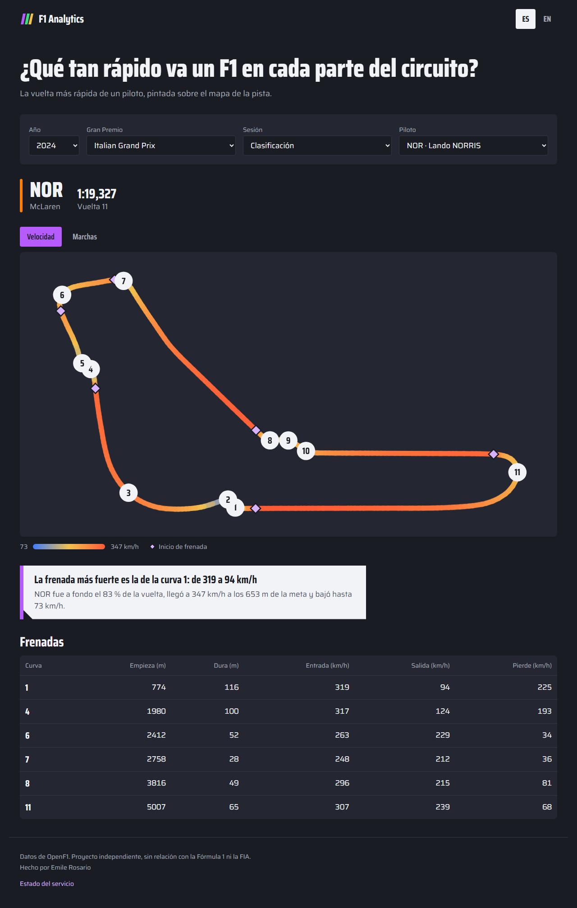

**Qué se ve en la pole de Monza 2024 (Lando Norris, 1:19,327):**

- Fue a fondo el **83 %** de la vuelta, el circuito de menos carga aerodinámica del calendario.
- Alcanzó **347 km/h** a los 653 m de la meta y bajó hasta **73 km/h**.
- La frenada más fuerte es la de la **curva 1**: de 319 a 94 km/h en 116 m.

<details>
<summary>Las mismas figuras, hechas con Matplotlib en el notebook 01</summary>

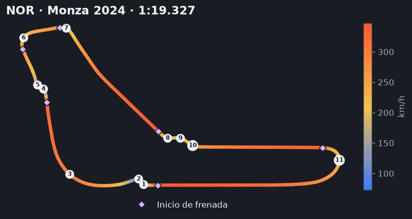
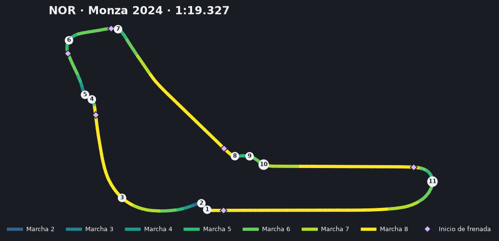

</details>

### 2. ¿Cuánto le costó a un piloto su estrategia de gomas?

La estrategia de todos los pilotos (qué compuesto, cuántas vueltas), el tiempo de vuelta contra la edad de la goma y cuánto se gasta cada compuesto, con una corrección opcional por el combustible que se va gastando.

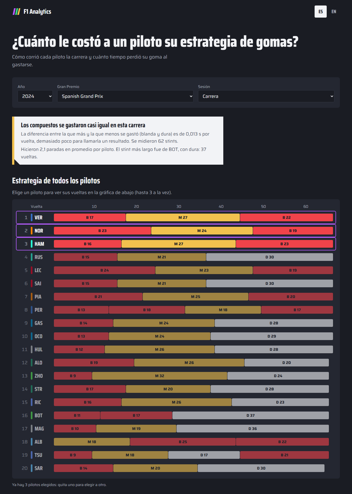

**Qué se ve en el Gran Premio de España 2024 (62 stints):**

- Con el combustible corregido, la blanda pierde **0,099 s por vuelta**, la media 0,089 y la dura 0,085.
- La diferencia entre la que más y la que menos se gasta es de **0,013 s por vuelta**: demasiado poco para llamarla un resultado. La web lo dice así en vez de inventar un ganador.
- Sin corregir el combustible, las tres parecen gastarse mucho menos (entre 0,026 y 0,039 s por vuelta), porque el coche se aligera y compensa el desgaste.
- Hicieron **2,1 paradas** en promedio por piloto. El stint más largo fue de Bottas, con la dura: 37 vueltas.

<details>
<summary>Las mismas figuras, hechas con Matplotlib en el notebook 02</summary>

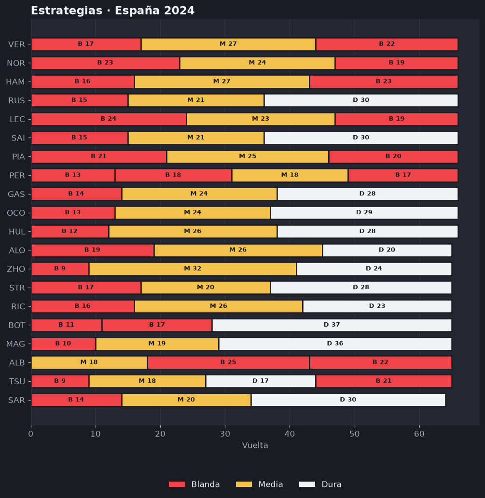
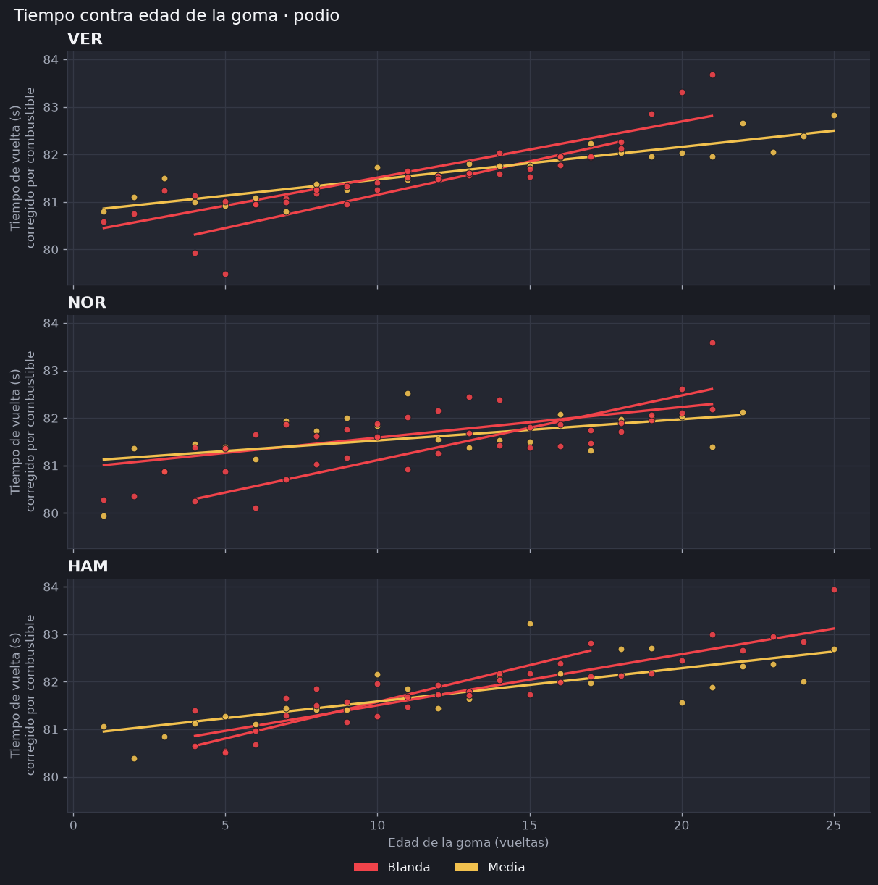
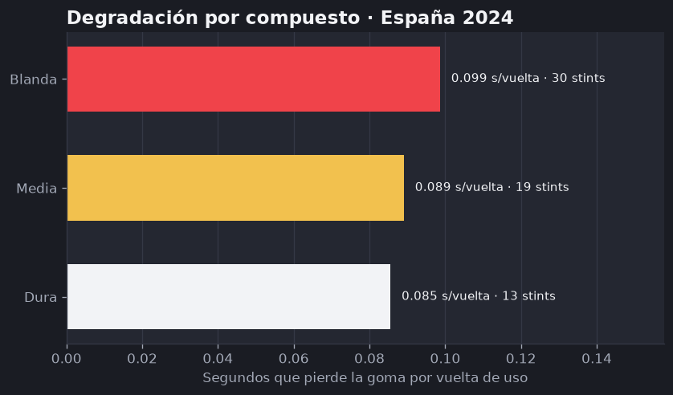

</details>

### 3. ¿Dónde le gana tiempo un piloto a otro?

Las vueltas de dos pilotos una encima de la otra, metro a metro: velocidad, acelerador, freno y la diferencia de tiempo acumulada. Un cursor recorre la vuelta (con mouse, tacto o teclado) y el mapa pinta cada uno de los 25 tramos del color de quien lo recorrió más rápido.

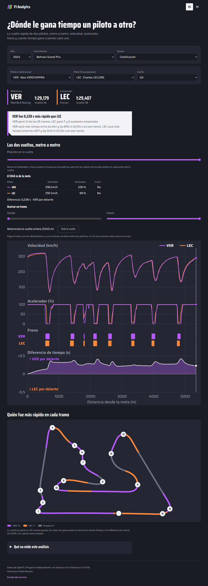

**Qué se ve en la Q3 de Bahréin 2024 (Verstappen 1:29,179 contra Leclerc 1:29,407):**

- Verstappen fue **0,228 s** más rápido.
- Ganó **12 de los 25 tramos**; Leclerc ganó 7 y otros 6 quedaron empatados (menos de 0,01 s de diferencia).
- Verstappen sacó **0,154 s** entre los 641 y los 855 m, y Leclerc recuperó **0,134 s** entre los 4917 y los 5131 m.

<details>
<summary>Las mismas figuras, hechas con Matplotlib en el notebook 03</summary>

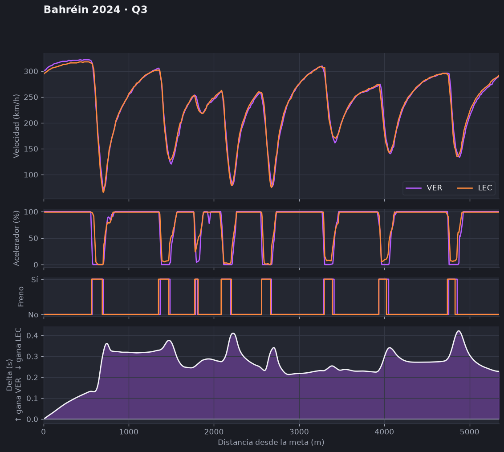
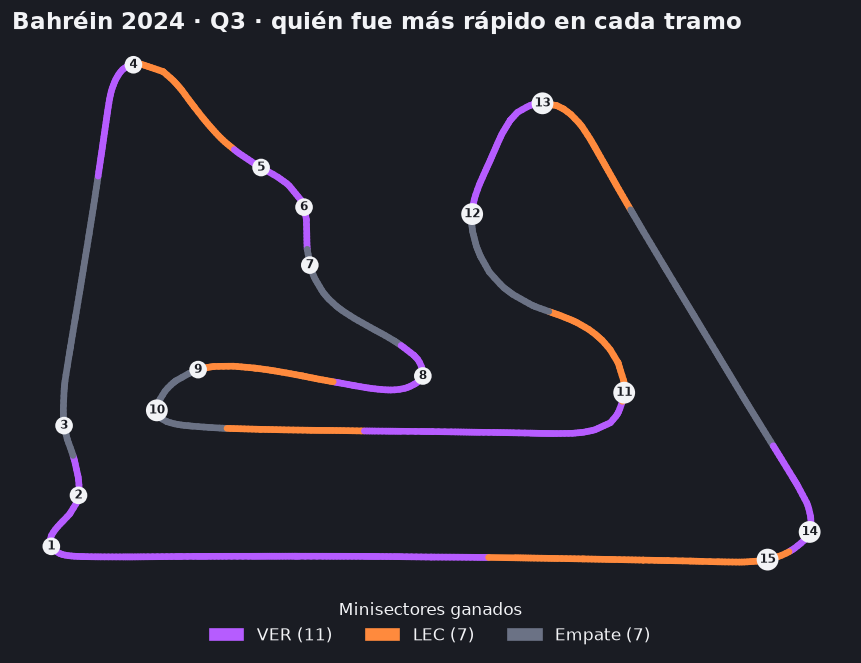

</details>

## Qué tan fiable es

Los datos públicos de OpenF1 traen unas 3,7 muestras por segundo, una cada 20 m a 250 km/h. Por eso:

- **El tiempo final de la comparación es exacto**: el cálculo se ajusta al tiempo oficial de cada vuelta.
- **A mitad de vuelta es una estimación.** Se midió contra los tiempos oficiales de sector en 10 comparaciones de la Q3 de 5 carreras de 2024 (`backend/scripts/validar_delta.py`): error medio **0,04 s**, máximo **0,13 s**. Sirve para decir quién fue más rápido en un tramo largo, no para discutir una milésima.
- **El delta está alisado, pero los lomos de las curvas lentas siguen.** Con una muestra cada ~20 m, una sola medida mala deja dientes de hasta 0,12 s que no son una ventaja real. Se promedia en ventanas de ~100 m: el dentado baja de 0,124 a 0,023 s, pero los lomos anchos que el delta hace en las frenadas fuertes solo bajan una mediana del 26 %. Lo que cuenta es el nivel al que se estabiliza después de la curva. El alisado también redondea cambios reales y sube el error medio de 0,035 a 0,042 s.
- **La degradación de gomas no es desgaste real.** Es la pendiente del tiempo de vuelta contra la edad de la goma; también se mezclan el tráfico, la temperatura y que el asfalto mejora. Con estos datos no se pueden separar.
- **Las diferencias pequeñas no se presentan como resultado.** Si dos pilotos o dos compuestos quedan a menos de un umbral, la web lo dice y no nombra ganador.

Cada análisis tiene, en su página, la lista de lo que no puede decir.

## Cómo está hecho

```
OpenF1 ──► backend/datos ──► backend/analisis ──► backend/api ──► frontend (Next.js)
           (único que habla     (funciones puras,     (FastAPI,       (mapas y gráficas
            con OpenF1,          sin red)              solo datos)     en SVG propio)
            con caché)
                                     └──► notebooks/ + graficos/ (Matplotlib, las figuras de arriba)
```

- **Backend:** Python 3.12, FastAPI, pandas y numpy, con `uv`. Las funciones de análisis son puras y se prueban sin red. **La API nunca manda textos para el usuario**, solo datos y códigos: el frontend los traduce.
- **Frontend:** Next.js 16, React 19, TypeScript, Tailwind v4 y `next-intl` (español e inglés). Los mapas y las gráficas son SVG propio, sin librería de gráficos.
- **Despliegue:** web en Vercel, API en Render.
- **Pruebas:** más de 350 en el backend (con OpenF1 simulado), 191 unitarias y 57 de extremo a extremo con Playwright en el frontend. CI en GitHub Actions en Linux y Windows.
- **Accesibilidad:** los controles se usan con teclado, el cursor de la telemetría tiene un deslizador para teclado y lectores de pantalla, y los compuestos y los pilotos llevan letra o código además de color.

Los notebooks de [`backend/notebooks/`](backend/notebooks/) cuentan cada análisis paso a paso, con datos reales ya ejecutados, y usan el mismo código que sirve la web.

## Documentación

- [`docs/contexto.md`](docs/contexto.md): qué es el proyecto, decisiones y alcance.
- [`docs/diseno-tecnico.md`](docs/diseno-tecnico.md): arquitectura, API y roadmap.
- [`docs/design.md`](docs/design.md): diseño visual.

## Correr en local

Con Docker (API en `:8000`, web en `:3000`):

```
docker compose up --build
```

Sin Docker:

```
# Backend (requiere uv)
cd backend
uv sync
uv run uvicorn f1analytics.api.main:app --reload

# Frontend (requiere Node 22)
cd frontend
npm ci
npm run dev
```

Pruebas:

```
cd backend && uv run pytest
cd frontend && npm test
```

Los notebooks necesitan internet y que no haya una sesión de F1 en vivo (OpenF1 bloquea entonces las consultas sin clave).

## Variables de entorno

| Variable | Dónde | Para qué |
|---|---|---|
| `NEXT_PUBLIC_API_URL` | Frontend (Vercel) | URL de la API. En local, `http://localhost:8000` (ver `frontend/.env.example`) |
| `ORIGENES_PERMITIDOS` | API (Render) | Dominios del frontend con permiso CORS, separados por comas. Por defecto `http://localhost:3000` |
| `ORIGEN_PREVIEW_REGEX` | API (Render) | Expresión regular de las URLs de preview de Vercel |

## Límites conocidos

- No hay sesiones en vivo: mientras una sesión está en curso, OpenF1 bloquea las consultas y la web lo avisa.
- Los circuitos que no están en `circuitos.json` (por ejemplo, Kuala Lumpur y Madring, nuevos de 2026) se analizan **sin números de curva**: no hay tabla de frenadas, el mapa no lleva números y no está girado como en la transmisión, y el largo es el medido en la telemetría. La web lo avisa. MultiViewer todavía no tiene sus datos.
- La comparación de telemetría no explica el porqué de una diferencia: una mejor frenada, una mejor trazada o un pie levantado se ven igual en el delta.
- Los 25 tramos son de igual longitud, no los minisectores oficiales (casi la mitad de los circuitos no tiene ninguno).

## Fuentes de datos

- Telemetría, vueltas y sesiones: [OpenF1](https://openf1.org), consultado en vivo.
- Números de curva y rotación de los mapas: copia estática de la API pública de [MultiViewer](https://multiviewer.app) (`backend/src/f1analytics/datos/circuitos.json`), generada una sola vez. La app no depende de MultiViewer mientras corre.

## Autoría

Hecho por [Emile Rosario](https://github.com/emile-rosario), con [Claude Code](https://claude.com/claude-code) como asistente de desarrollo: Claude escribió y probó el código por Pull Requests pequeños y Emile revisó y mergeó cada uno.

## Licencia

[MIT](LICENSE). Proyecto independiente, sin relación con la Fórmula 1 ni la FIA. No usa logos, tipografías ni marcas oficiales de la F1.
